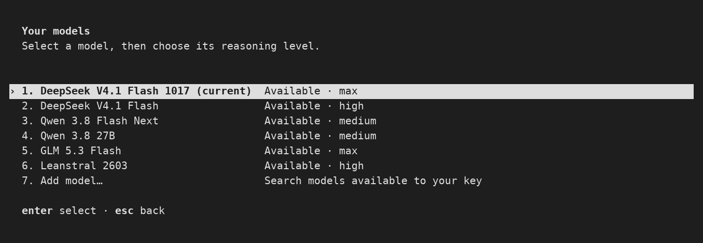
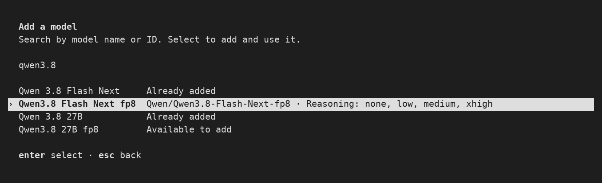

# Lemex CLI

Lemex is a local coding agent based on OpenAI Codex. It runs as `lemex` and keeps its configuration and state in `~/.lemex`, so you can use it alongside Codex.

External analytics and feedback reporting are removed. Local logs and token usage are preserved. Custom OpenTelemetry exporters require explicit configuration.

Lemex does not include ChatGPT cloud tasks, account sign-in, or the Codex desktop-app installer. Developer test tooling is kept outside the installed CLI.

Normal sessions use the embedded backend. The persistent background daemon is opt-in, and never downloads or updates itself.

## Install

With Node.js 22 or later on macOS, Linux, or Windows through WSL2:

```sh
npm install -g @lemmy00/lemex
```

npm installs the precompiled runtime for your computer (x64 or ARM64), including its helper tools. Rust, Python, and a compiler are not required. Run `lemex setup` to configure your provider; existing settings in `~/.lemex` are preserved. Update with `npm install -g @lemmy00/lemex@latest`.

Alternatively, build from source with Git, Python 3.11+, and a C/C++ toolchain:

```sh
git clone --depth 1 https://github.com/Lemmy00/lemex.git
cd lemex
./scripts/install/install_from_source.sh
```

See the [source installation guide](docs/install.md#source-build-requirements) for platform prerequisites and build options. Rust is installed automatically if needed.

Fresh installations use RCP's `deepseek-ai/DeepSeek-V4.1-Flash-1017` with `max` reasoning, a 240k-token context, and compaction at 220k. The bundled catalog includes DeepSeek V4.1, Qwen 3.8, GLM 5.3 Flash, and Leanstral; see [available models and reasoning efforts](docs/config.md#model-catalog-and-tools).

## Run

Set up your API key once, then start Lemex:

```sh
lemex setup
lemex
```

Setup asks for a hidden API key, discovers models, and lets you choose a shortlist, default model, and supported reasoning level. RCP (`https://inference.rcp.epfl.ch/v1`) is the default; you can use another Responses-compatible provider. Run setup again to replace the key; Enter keeps the saved key. Keys stay in the credential store, outside `config.toml`.

For scripts, `LEMEX_API_KEY` overrides the saved key. After replacing a key, run `unset LEMEX_API_KEY` if your terminal still exports an old one. Change the endpoint with `lemex setup --base-url "https://api.example.com/v1"`.

For a single task, run from your project's Git repository:

```sh
lemex exec "Explain this codebase"
```

Outside a Git repository, add `--skip-git-repo-check`.

Interactive chats receive titles that identify the task and its specific subject. Use `/rename` for an editable suggestion based on the original request and recent conversation, or `/rename <title>` to set your own name.

## Models

Lemex discovers model candidates using your provider's API key. Reasoning choices follow the provider's advertised settings or verified RCP profiles; when unknown, Lemex uses the provider default.

The `/model` picker shows your shortlist and availability. RCP starts with six curated models; custom providers start with the configured default. To customize it:

1. Open `/model` and choose **Add model…**.
2. Search by name or ID and select results to add or remove them without switching models.
3. Press Esc to return to your shortlist, then choose your default model and reasoning.

<details>
<summary>See the model picker and search</summary>





Available models depend on your API key.

</details>

Or use the terminal:

```sh
lemex models --search qwen
lemex models shortlist     # Edit your shortlist without switching
lemex model                # Save a default model and reasoning
```

See [model selection](docs/authentication.md#model-selection) for reasoning settings and removing or resetting saved models.

## Customize

Edit `~/.lemex/config.toml` to change the provider, context limits, reasoning display, or MCP servers. An optional `models.json` supplies offline metadata. Use `lemex -m "<model-id>"` for one launch.

Optional environment variables:

| Variable         | Purpose                                                                                                              |
| ---------------- | -------------------------------------------------------------------------------------------------------------------- |
| `LEMEX_HOME`     | Configuration and state directory; defaults to `~/.lemex`. Set it before `lemex setup` to use a different directory. |
| `LEMEX_BASE_URL` | Override the default RCP endpoint (`https://inference.rcp.epfl.ch/v1`).                                              |

See [Configuration](docs/config.md) for provider setup and catalog customization, and [Installation](docs/install.md) for build options and config import.

To check your setup, run `lemex doctor`.

Licensed under [Apache-2.0](LICENSE).
